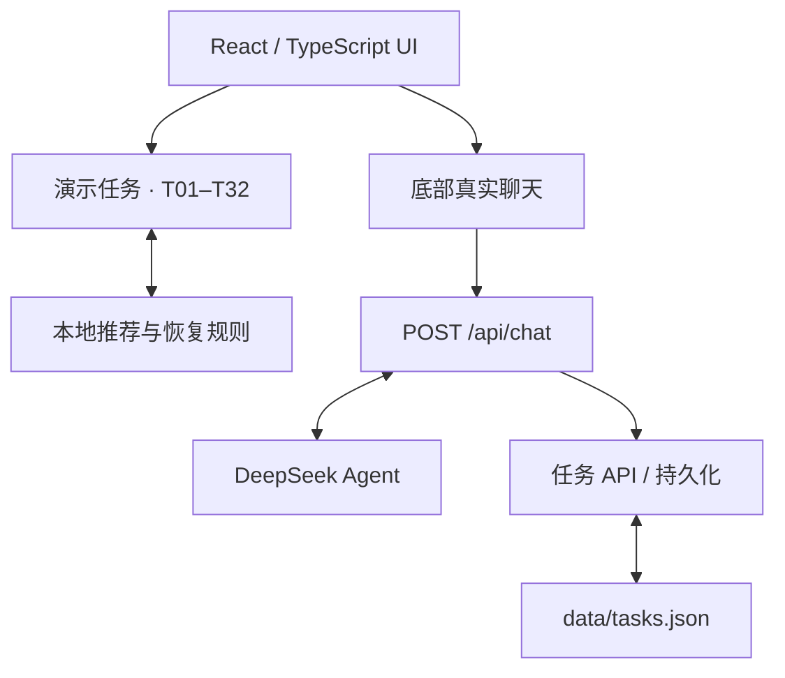

# NowDo

> **From to-do to done.** 从待办，到办成。
>
> 让计划适应生活，而不是让生活迁就计划。


NowDo 是基于 TokeNow「小明待办清单智能体」技术实战题开发的移动端优先 AI 待办与日程助手。本项目结合**真实中文对话式任务管理 Agent** 与 **可交互的动态任务管理产品原型**，探索从记录任务到推动任务执行的完整体验。

**传统待办清单告诉用户还有什么没做，NowDo 尝试帮助用户决定现在能做什么，以及计划未完成后如何继续。**

[快速开始](#快速开始) · [实战题验收](#实战题验收) · [产品功能](#产品功能) · [技术实现](#技术实现) · [能力边界](#能力边界与后续方向)

## 快速开始

### 1. 启动项目

环境要求：Node.js **24.12 或更高版本**（含 npm）。在项目根目录执行：

```bash
npm ci
npm run dev
```

打开浏览器：[http://127.0.0.1:3000](http://127.0.0.1:3000)。

### 2. 选择体验方式

| 方式 | 操作 | 是否需要 API Key |
| --- | --- | --- |
| **产品 Demo** | 打开 [Demo 入口](http://127.0.0.1:3000/?mode=demo)，体验完整界面与预设交互 | 否 |
| **真实 Agent** | 配置 `.env` 并重启服务，通过网页底部聊天或 `POST /api/chat` 管理真实任务 | 是 |
| **本地测试** | 执行 `npm test`，使用模拟模型及临时任务文件 | 否 |

未配置密钥时，底部聊天显示演示摘要；配置后，普通网页入口的底部聊天默认连接真实 Agent。

### 3. 配置真实 Agent（可选）

将 `.env.example` 复制为项目根目录下的 `.env`，填写自己的 DeepSeek API 密钥并重启服务。

| 环境变量 | 用途 |
| --- | --- |
| `DEEPSEEK_API_KEY` | DeepSeek API 密钥，仅由服务端读取 |
| `DEEPSEEK_MODEL` | 模型名称，默认 `deepseek-flash` |
| `PORT` | 本地服务端口，默认 `3000`，监听 `127.0.0.1` |

正式启动：

```bash
npm run build
npm start
```

更多本地调试及 API 请求示例见 [GETTING_STARTED.md](GETTING_STARTED.md)。

## 实战题验收

原题要求通过中文自然语言对话帮助用户管理待办。在真实 Agent 模式中，可按以下顺序验证基础功能。建议使用一项新的测试任务，以免与已有任务混淆。

| 功能 | 示例输入 | 预期行为 |
| --- | --- | --- |
| 创建任务 | 帮我记一下洗衣服 | 创建一条待办 |
| 查询任务 | 我有哪些待办？ | 返回任务列表，包含洗衣服 |
| 标记完成 | 衣服洗好了 | 将对应任务标记为已完成 |
| 单条删除 | 删除洗衣服这项任务 | 定位并删除对应任务 |

上表为建议验收对话及预期结果，并非逐字固定的模型回复。完整原题与验收示例可通过 `git show 6116143:README.md` 查看，提交说明见 [SUBMIT.md](SUBMIT.md)。

真实 Agent 还支持按条件查询任务、对明确起止时段进行冲突预检。通过真实聊天创建的任务写入本地 `data/tasks.json`，重启服务后仍可查询。

## 产品功能

### 为什么做 NowDo？

待办工具往往擅长记录计划，却难以解决计划与实际执行之间的落差：用户可能没有足够时间、精力不足，或因为任务过难而迟迟无法开始。未完成的任务持续积压，也会增加下一次行动的决策成本。

NowDo 围绕「当前状态 → 行动推荐 → 执行反馈 → 任务调整」设计产品体验。

| 模块 | 核心体验 | 当前实现 |
| --- | --- | --- |
| **AI Insight · 当下** | 结合当前时间、日程与任务状态，展示行动建议 | 本地规则与演示数据 |
| **Task Pool · 任务池** | 管理任务、完成状态与优先级 | 可交互前端原型 |
| **Calendar · 周日历** | 可视化一周计划，展示时间安排及任务状态 | 可交互前端原型 |
| **Smart Focus · 智能推荐** | 根据可用时间和精力匹配适合执行的行动 | 本地推荐规则 |
| **Smart Recovery · 任务恢复** | 根据未完成原因提供调整方案 | 本地恢复规则 |
| **Agent · 中文对话** | 通过自然语言创建、查询、完成、删除单条任务及进行冲突预检 | 真实 DeepSeek + 服务端任务 API |

界面支持中英文切换、深浅色主题及移动端布局。

### 推荐演示流程

Demo 固定在 **2026 年 11 月 27 日 12:00（Europe/Berlin）**，包含 T01–T32 共 32 项一周日程。

1. 在「当下」查看 AI Insight 与当前日程建议。
2. 在「任务池」查看任务状态，标记完成或调整优先级。
3. 在「计划」查看周日历，观察任务变化。
4. 在「洞察」体验 Smart Focus，切换可用时间与精力状态。
5. 通过 Smart Recovery 调整未完成任务，并在其他页面查看更新。

四个演示页面共用同一份演示任务数据。刷新网页会恢复 32 项初始日程并清空演示聊天；语言、主题等偏好保存在浏览器中。

## 技术实现

### 架构与数据流



**当前版本的关键区分：** 四个产品演示页面始终使用演示任务；真实聊天通过服务端管理独立的持久化任务。两者尚未共享实时任务状态。AI Insight、Smart Focus、Smart Recovery 与演示聊天摘要均由本地规则生成，并非每次操作都调用大模型。

### 技术栈

| 层级 | 技术 |
| --- | --- |
| 前端 | React、TypeScript、CSS |
| 构建 | esbuild |
| 服务端 | Node.js、Express |
| 参数校验 | Zod |
| 模型接入 | OpenAI SDK（连接 DeepSeek） |
| 数据持久化 | 本地 JSON 文件 |

### 项目结构

```text
src/       # 页面、浏览器设置、演示任务、推荐和恢复规则
public/    # 网页入口、样式与标志
server/    # API、真实 Agent、任务持久化及测试
shared/    # 前后端共用的任务、日期和对话类型
```

### API

| 接口 | 说明 |
| --- | --- |
| `POST /api/chat` | 中文自然语言任务管理，使用实时日期，支持传入 `timeZone` |
| `/api/tasks` | 独立的任务 CRUD 接口 |

详细接口定义见 [OpenAPI](server/openapi.yaml)。

## 测试与质量验证

以下命令可在本地独立执行，无需为本地测试配置模型密钥：

```bash
npm run build       # 构建检查
npm run typecheck   # TypeScript 类型检查
npm run lint        # Lint 检查
npm test            # 本地测试
```

本地测试使用模拟模型与临时任务文件。真实 Agent 的边界验证重点关注上下文准确性、时间冲突、零空闲时间、非法参数和批量操作限制；模型调用与本地确定性测试应分别评价。

## 数据与隐私

- API 密钥仅由服务端读取，不应提交至公开仓库。
- 工作区的 `.env` 与 `data/` 均由 Git 忽略。
- 使用真实 Agent 时，任务标题、状态、日期、开始时间及近期对话会发送给 DeepSeek，并可能产生 API 费用。
- 当前服务面向本机单用户场景，不作为多用户生产服务使用。

## 能力边界与后续方向

本项目定位为 **Interactive Product Prototype + Agent Proof of Concept（交互式产品原型与智能体技术可行性验证）**。

| 当前限制 | 后续方向 |
| --- | --- |
| 演示页面与真实 Agent 使用独立数据源 | 统一任务数据源，打通真实日历、推荐与恢复流程 |
| 冲突预检需要明确的同日起止时间；缺少结束时间时可能无法核实空档 | 完善日程时长与跨日时间表达 |
| Agent 暂未开放改期、批量操作和任务拆解工具 | 在参数校验与权限控制基础上逐步扩展工具能力 |
| 推荐与恢复主要依赖本地预设规则 | 发展个性化推荐及动态任务调整能力 |
| 提醒、通知及外部日历集成尚未启用 | 接入通知及第三方日历服务 |

## 项目文档

- [开发指南 · GETTING_STARTED.md](GETTING_STARTED.md)：本地调试与 API 请求示例
- [接口定义 · OpenAPI](server/openapi.yaml)：任务 API 说明
- [提交说明 · SUBMIT.md](SUBMIT.md)：实战题提交信息
- 原始编程题：`git show 6116143:README.md`

---

**NowDo · From to-do to done.**
